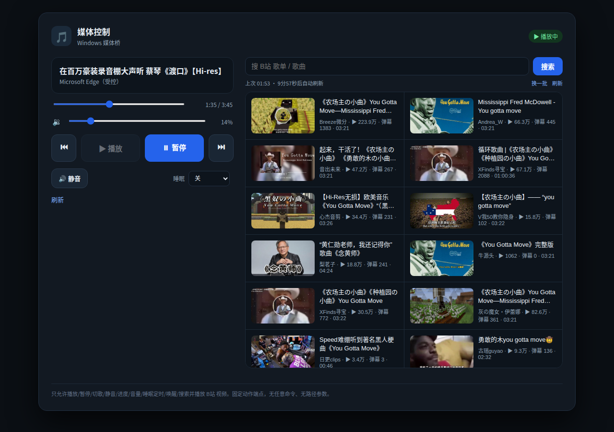

<div align="center">

# media-control

**躺在被窝里，用手机控制电脑上的音乐**

Windows SMTC · 受控 Edge + CDP · B 站搜索直连 · 睡眠定时 · PC 唤醒 · Android 客户端 · OTA 更新


[项目概览](#1-项目概览) · [核心特性](#2-核心特性) · [界面](#3-界面) · [系统架构](#4-系统架构) · [快速开始](#6-快速开始) · [Android](#7-android-客户端) · [API](#8-api)

</div>

> **项目定位：家庭局域网的个人工具，不是远程桌面。**
> 只做「媒体控制」一件事：看现在放什么、暂停/继续、切歌、拖进度、调音量、搜歌点播、定时暂停。
> 不碰桌面、不抢焦点、不需要把 Windows 解锁到桌面。

**2 个进程** · **零第三方依赖（服务端）** · **10 分钟自动刷新** · **手机网页与 Android 客户端并存**

---

## 目录

- [1. 项目概览](#1-项目概览)
- [2. 核心特性](#2-核心特性)
- [3. 界面](#3-界面)
- [4. 系统架构](#4-系统架构)
- [5. 关键设计](#5-关键设计)
- [6. 快速开始](#6-快速开始)
- [7. Android 客户端](#7-android-客户端)
- [8. API](#8-api)
- [9. 部署](#9-部署)
- [10. 测试与验证](#10-测试与验证)
- [11. 已知限制](#11-已知限制)
- [12. 工程实践与踩坑](#12-工程实践与踩坑)
- [13. 目录结构](#13-目录结构)
- [14. 安全须知](#14-安全须知)
- [15. Roadmap](#15-roadmap)

---

## 1. 项目概览

### 1.1 要解决的问题

晚上躺在床上，电脑在书桌上接着音箱放歌。想切歌、暂停、把音量调小，或者干脆关掉，都得爬起来走到电脑前。

远程桌面太重：要解锁、要看清桌面、要在一堆窗口里点来点去；手机上的远程控制 App 还要装客户端、配对、保持后台。很多时候我只是想「把歌关掉」或者「换一首」，不需要看到整个桌面。

### 1.2 方案

把「放」和「控」拆开：

- **放**：一个专用受控浏览器（Edge，独立 profile）负责打开 B 站并播放；
- **控**：一个网页（服务器上跑）负责展示状态、发指令；
- **桥**：Windows 上的小服务，把网页指令翻译成 SMTC / 音量 / CDP 动作；
- **客户端**：网页直接用；另附一个 Android WebView 壳，带内置登录与 OTA 更新。

手机、平板、另一台电脑，打开浏览器就能用；Android 客户端只是同一页面的原生外壳。

## 2. 核心特性

| 能力 | 实现 | 说明 |
|---|---|---|
| 播放 / 暂停 | WinRT SMTC / CDP | 优先控制受控 Edge 的 video，失败回退系统媒体会话 |
| 上一首 / 下一首 | 系统媒体键（SMTC） | 支持切歌的播放器有效；B 站单视频通常忽略 |
| 系统音量 | pycaw | 调 Windows 主音量，不是单个网页的音量 |
| 静音 | pycaw | 系统级静音开关，状态随 `/api/status` 返回 |
| 进度拖动 | CDP `video.currentTime` | 仅受控 Edge 播放时可用，SMTC 模式自动禁用 |
| 睡眠定时 | 服务端定时器 | 15/30/45/60/90/120 分钟，到点自动暂停 |
| PC 在线检测 | TCP 22 探活 | 电脑离线时页面快速显示并禁用控制 |
| PC 唤醒 | Wake-on-LAN | 服务端发 magic packet，需要网卡与 BIOS 支持 |
| B 站搜索 | 受控 Edge + CDP | 返回封面、标题、UP 主、播放量、弹幕数、时长 |
| 点播 | CDP `Page.navigate` | 在专用播放器标签打开并播放，自动复用标签 |
| 自动刷新 | 前端 10 分钟定时 | 页面不可见时不刷，回来补刷 |
| 登录鉴权 | Basic + 飞书 OAuth | 飞书 OAuth 可选，open_id 白名单 |
| Android 客户端 | WebView + 配置注入 | 首次自动登录，OTA 更新，节省得手输密码 |

## 3. 界面



左侧是遥控器（当前播放、进度、上一首/播放/暂停/下一首、静音、睡眠定时），右侧是 B 站搜索结果网格。窄屏自动退回单列，手机竖屏也能用。

## 4. 系统架构

### 4.1 总览

```
手机浏览器 / Android 客户端
        │ HTTPS + Basic Auth（Nginx / Tunnel）
        ▼
media-web（Linux，Python 标准库，:8097）
        │ SSH 固定命令（参数白名单）
        ▼
Windows Bridge（127.0.0.1:8765）
        ├─ WinRT SMTC / pycaw（播放、切歌、静音、系统音量）
        └─ CDP 127.0.0.1:9222（受控 Edge：标签、搜索、点播、进度）
        ▼
受控 Edge 播放 → Windows 音频输出 → 音箱
```

### 4.2 一次点歌的完整过程

```
1. 手机输入关键词 → GET /api/search?q=xxx&page=1
2. media-web 校验参数 → ssh <windows-host> "curl 127.0.0.1:8765/cdp/search?q=..."
3. 桥通过 CDP 让受控 Edge 打开 B 站搜索页
4. 桥等待渲染，执行 JS 抓视频卡片 → 返回 JSON
5. 前端渲染网格；用户点卡片 → POST /api/open?bv=BVxxxx
6. 桥导航到视频页 → 执行 video.play()
7. 前端每 5 秒轮询 /api/status 更新进度与状态
```

## 5. 关键设计

### 5.1 为什么拆成三个进程

Web 服务跑在 Linux 服务器上（常开、有反向代理和证书），桥必须跑在 **Windows 交互桌面会话** 里——UI Automation 和音频控制离开交互会话就用不了，所以桥不能和 Web 服务同机同进程。

### 5.2 为什么用受控 Edge 而不是接口

不保存 B 站 Cookie、不模拟登录，直接在真实浏览器里操作：登录态天然复用，页面改版时改选择器即可，也不会触发风控。

### 5.3 为什么所有动作都是固定端点

网页不能传任意命令、任意路径、任意 URL 给服务器。每个动作对应一个写死的分支，参数只接受整数、浮点秒数或 BV 号，从根上杜绝注入。

### 5.4 睡眠定时为什么放在服务端

手机锁屏后，浏览器和 App 都可能被杀掉或进入 Doze；服务端常开，定时器更可靠，而且网页和 Android 客户端共用同一份逻辑。

## 6. 快速开始

### 6.1 组件清单

| 位置 | 组件 | 依赖 |
|---|---|---|
| Windows | 受控 Edge | 无（系统自带/安装 Edge） |
| Windows | `bridge/dodaios-bridge.py` | `websocket-client`、`pycaw`、`pywin32`、`psutil` |
| Linux | `server/app.py` | 无（Python 标准库） |
| Linux | systemd + 反向代理 | 可选 |
| Android | `android/` | JDK 17、Android SDK build-tools + platform 34 |

### 6.2 配置

复制 `config.example.env`，按需填写：

| 变量 | 说明 |
|---|---|
| `MEDIA_WEB_USER` / `MEDIA_WEB_PASSWORD` | 网页 Basic 认证；任一为空时拒绝登录 |
| `MEDIA_WEB_HOST` / `MEDIA_WEB_PORT` | 监听地址与端口，默认 `127.0.0.1:8097` |
| `MEDIA_WIN_HOST` | Windows 的 IP 或 SSH 主机别名（探活与 SSH 都用它） |
| `MEDIA_BRIDGE_URL` | 桥地址，默认 `http://127.0.0.1:8765/` |
| `MEDIA_WIN_MAC` | Windows 网卡 MAC；用于 Wake-on-LAN，留空则禁用唤醒 |
| `FEISHU_APP_ID` / `FEISHU_APP_SECRET` | 可选，飞书 OAuth 登录 |
| `FEISHU_REDIRECT_URI` | 可选，飞书 OAuth 回调地址 |

### 6.3 三步启动

**第一步：Windows 侧起桥**

```bat
pip install websocket-client pycaw pywin32 psutil
python dodaios-bridge.py
curl http://127.0.0.1:8765/health
```

建议用计划任务在登录时启动，勾选「只在用户登录时运行」。

**第二步：Windows 侧起受控 Edge**

```powershell
powershell -ExecutionPolicy Bypass -File register-music-edge.ps1
```

它会用独立 profile（`%USERPROFILE%\edge-music`）启动 Edge，CDP 只绑 `127.0.0.1:9222`。B 站登录可选。

**第三步：Linux 侧起网页**

```bash
mkdir -p /opt/media-web
cp server/app.py /opt/media-web/
cp config.example.env /etc/media-web.env   # chmod 600
systemctl enable --now media-web
```

浏览器打开 `http://服务器IP:8097/`。

## 7. Android 客户端

`android/` 是一个不带第三方库的 WebView 壳：

- 首次启动读取打包进 assets 的默认配置，自动登录；登录失败才显示预填好的登录页；
- 右上角菜单：刷新 / 检查更新 / 重新登录；
- 更新走 OTA：启动时拉取 JSON 清单，比版本号新就下载 APK 并调起安装。

### 7.1 打包

1. 复制配置（**不要提交**）：
   ```bash
   cd android
   cp config.example.properties config.properties
   # 编辑 base / user / pass / update
   ```
2. 打包：
   ```bash
   SDK=$HOME/Android/Sdk ./build.sh
   # 产物 MediaControl-v<versionName>.apk
   ```
3. `config.properties` 只在构建时注入 APK 的 `assets/defaults.properties`，源码里没有账号密码。

> 签名密钥 `keystore.jks` 默认生成在 `android/` 下，已被 gitignore。**务必自己备份**：换签名后无法覆盖安装，只能卸载重装。

### 7.2 OTA 清单格式

```json
{"version":"1.2","url":"https://your-host/apps/MediaControl-v1.2.apk","notes":"更新说明"}
```

把清单和 APK 放到任意静态 HTTP 服务上，把清单 URL 填到 `config.properties` 的 `update=`。客户端比较 `versionName`（`major.minor.patch`）后提示更新。建议把 APK 放在不公开列目录的路径，并保持签名一致。

## 8. API

| 方法 | 路径 | 说明 |
|---|---|---|
| GET | `/` | 控制页面（Basic / cookie / 飞书登录） |
| GET | `/api/status` | 曲目、App、播放状态、音量、静音、进度、PC 在线、睡眠定时 |
| GET | `/api/pc` | Windows 是否在线、是否配置了唤醒 |
| GET | `/api/videos` | 抓当前搜索页的卡片 |
| GET | `/api/search?q=&page=` | B 站搜索 |
| GET | `/api/tabs` | 浏览器标签页（兜底） |
| POST | `/api/pause` / `/api/play` | 暂停 / 播放 |
| POST | `/api/next` / `/api/prev` | 上一首 / 下一首（系统媒体键） |
| POST | `/api/mute` | 切换系统静音 |
| POST | `/api/seek?pos=` | 跳转进度（秒，仅 CDP） |
| POST | `/api/volume?level=` | 系统音量 0–100 |
| POST | `/api/sleep?min=` | 睡眠定时：0/15/30/45/60/90/120 分钟 |
| POST | `/api/wake` | 发送 Wake-on-LAN magic packet |
| POST | `/api/open?bv=` | 打开并播放指定视频 |
| POST | `/api/tab?id=` | 切换标签页 |

所有 POST 需要 `X-CSRF-Token` 头（页面内注入），并受每 IP 限速与单动作锁保护。

## 9. 部署

```bash
# 1. systemd 服务
cp deploy/media-web.service /etc/systemd/system/
systemctl daemon-reload && systemctl enable --now media-web

# 2. 反向代理（示例：Caddy）
# media.example.com {
#     reverse_proxy 127.0.0.1:8097
# }
```

**不要把 8765 / 9222 暴露到公网。**

## 10. 测试与验证

| 检查 | 方法 |
|---|---|
| 桥存活 | `curl http://127.0.0.1:8765/health` |
| CDP 可用 | `curl http://127.0.0.1:9222/json/version` |
| 反代与鉴权 | 未认证访问应返回 401 |
| 播放链路 | 网页点「播放」，观察 Windows 媒体会话变化 |
| 进度/静音 | 播放 B 站视频后拖进度条、点静音，看状态是否跟随 |
| PC 唤醒 | 电脑睡眠后点「唤醒电脑」；失败先查网卡 WoL 与 BIOS |

## 11. 已知限制

- Windows 必须开机且用户已登录，桥不在时无法控制。
- 受控 Edge 必须运行；CDP 挂了搜索和点播就没法用。
- 系统音量与静音是全局的，会同时影响电脑上其他声音。
- 「上一首/下一首」依赖播放器响应系统媒体键；B 站单视频通常无效。
- 进度拖动只在 CDP 后端可用（SMTC 模式没有进度）。
- 唤醒成功率取决于网卡驱动、BIOS（ErP / Power On by PCIe）与电源状态；部分网卡在 Windows 里不暴露 WoL 选项。
- B 站页面结构会变，列表变空时需要更新选择器。
- 同一关键词短时间刷新通常还是同一批结果，用「换一批」翻页看更多。

## 12. 工程实践与踩坑

| 坑 | 现象 | 处理 |
|---|---|---|
| UI Automation 读不到 | SSH 里直接跑 bridge 拿不到媒体信息 | 桥必须跑在 **session 1 交互会话**里 |
| CSRF 每次重启失效 | 页面按钮全 403 | token 持久化到文件，前端遇 403 自动刷新 |
| URL 里的 `&` 被 cmd 拆开 | 搜索参数丢失 | 整条 URL 加双引号 |
| 默认 profile 被禁调试 | Chrome 136+ 静默禁用 CDP | 必须用独立 `--user-data-dir` |
| SSH 反向隧道 `localhost` 解析 | `Empty reply from server` | Windows 把 localhost 解析成 `::1`，用 `127.0.0.1` |
| 手机锁屏定时器丢 | 到点没暂停 | 睡眠定时放服务端，不依赖前端存活 |

## 13. 目录结构

```
media-control/
├── server/app.py                 # 网页 + API（Linux）
├── bridge/dodaios-bridge.py      # Windows 桥（SMTC / 音量 / CDP）
├── android/
│   ├── AndroidManifest.xml
│   ├── build.sh
│   ├── config.example.properties
│   └── src/com/example/mediacontrol/MainActivity.java
├── deploy/
│   ├── media-web.service         # systemd 模板
│   ├── start-music-edge.bat      # 受控 Edge 启动模板
│   └── register-music-edge.ps1   # 计划任务模板
├── config.example.env
├── docs/screenshot.png
└── README.md
```

## 14. 安全须知

- 网页只提供固定动作，没有任意命令 / 路径 / URL 执行。
- 服务端校验全部参数：音量 0–100，进度 0–86400 秒，睡眠 0/15/30/45/60/90/120，BV 号 `^BV[0-9A-Za-z]+$`。
- Basic 认证 + 持久化 CSRF + 每 IP 限速 + 单动作锁。
- 桥与 CDP 只绑 `127.0.0.1`。
- 仓库不含密码、域名、IP、主机名或个人路径；Android 配置在本地 `config.properties`，已 gitignore。
- 家庭场景请优先 VPN / Tailscale / Cloudflare Access。

## 15. Roadmap

- [x] 上一首/下一首、静音、进度拖动
- [x] 睡眠定时
- [x] PC 在线检测与 Wake-on-LAN
- [x] Android 客户端与 OTA
- [ ] 收藏夹 / 稍后再看（受控 Edge 登录后扩展）
- [ ] 歌词显示
- [ ] 飞书卡片按钮直接控制
- [ ] macOS 版本（已完成：[media-control-mac](https://github.com/standbyme626/media-control-mac)）

## License

MIT
